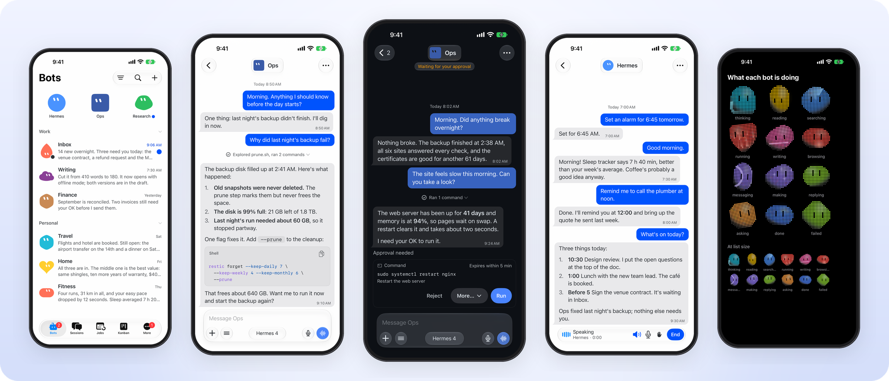
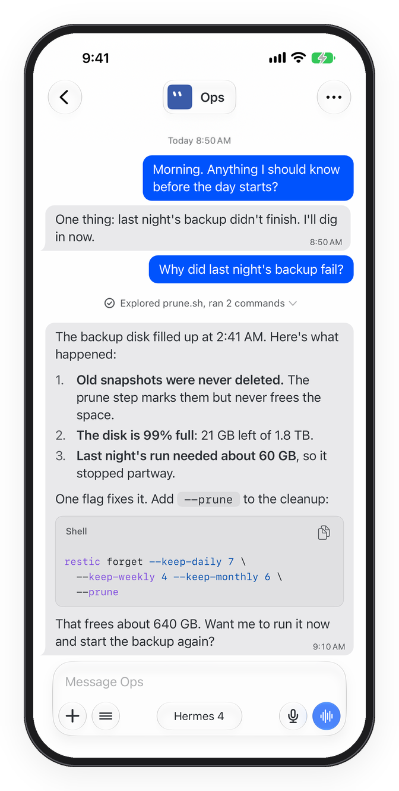
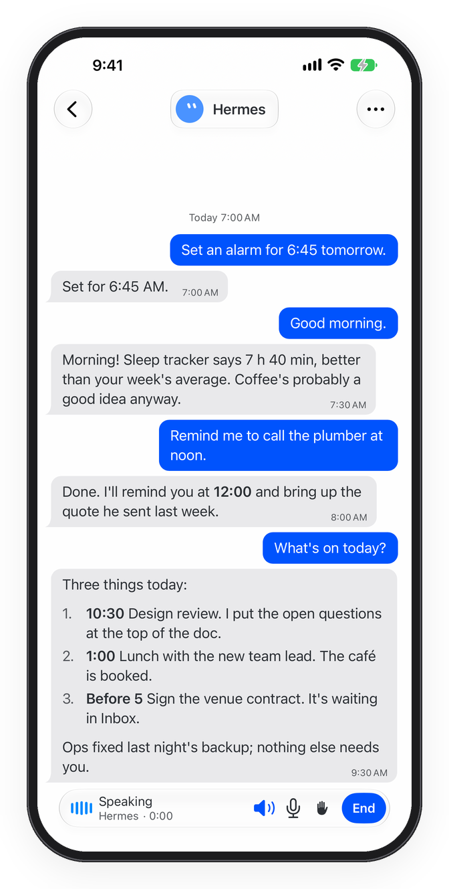
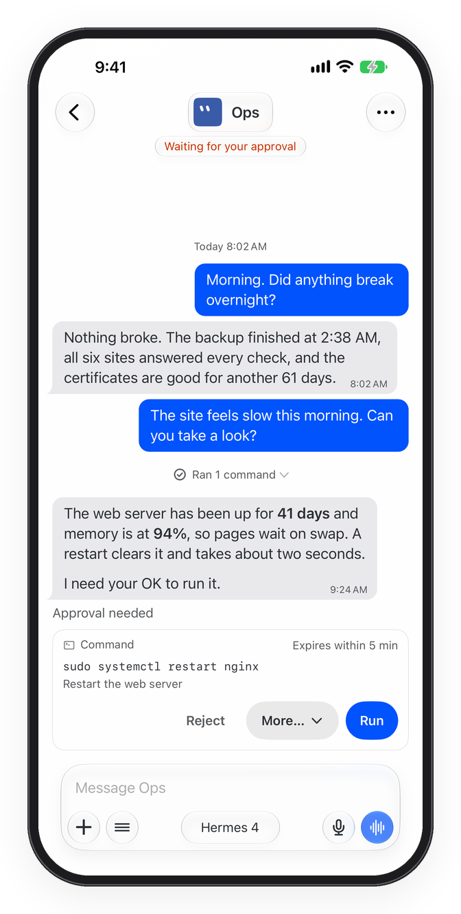
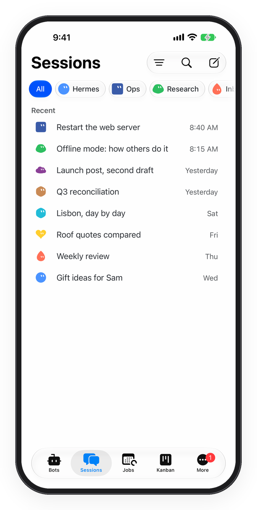
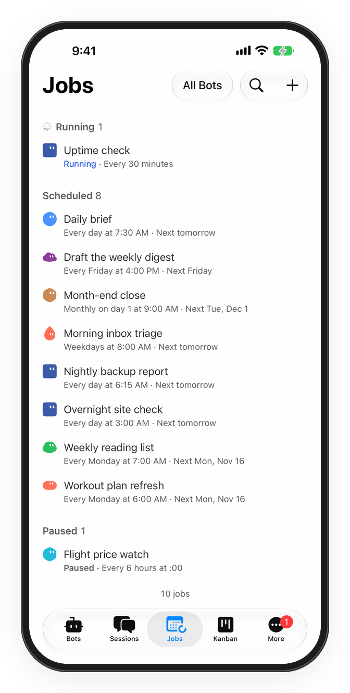
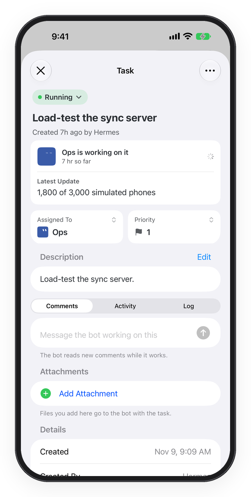
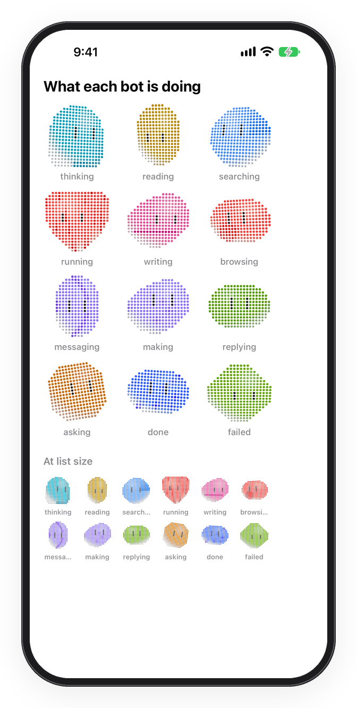
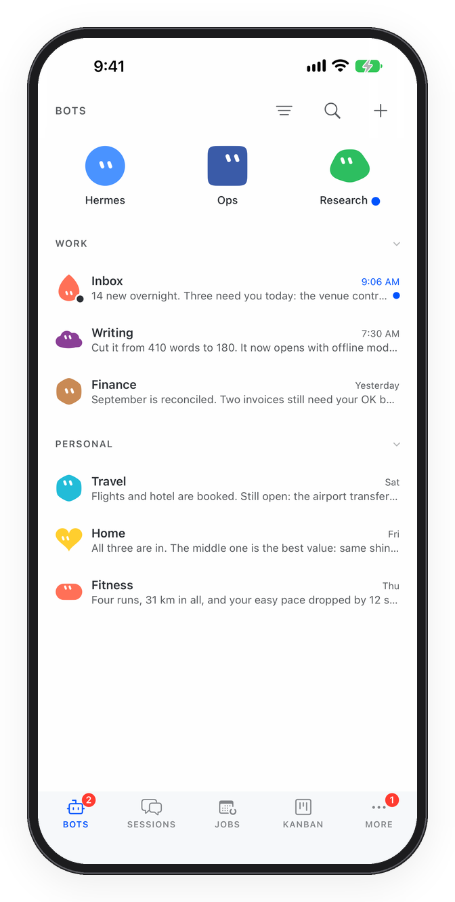
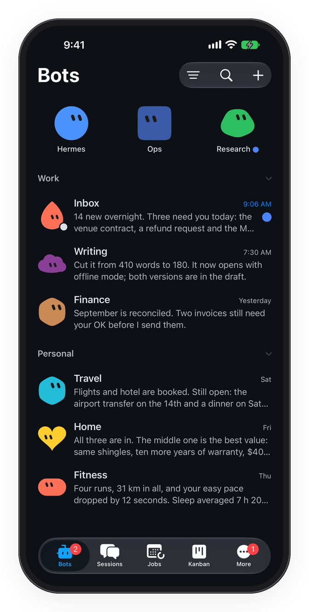

<div align="center">


# Hermes HQ

**Your Hermes agents, in your pocket.**

A fast, native iPhone, iPad and Mac app for [Hermes Agent](https://github.com/NousResearch/hermes-agent):
chat with your bots, approve what they want to run from the lock screen, talk to them out loud, and watch their
jobs, tasks and browsers, all against the Hermes running on your own computer.

[](https://apps.apple.com/us/app/id6816242629)
[](https://testflight.apple.com/join/vUsk6C3U)
[](https://gethermeshq.com/download/Hermes-HQ.dmg)
<br>
[](LICENSE)




</div>

---

<p align="center">
<a href="#why-hermes-hq">Why</a> ·
<a href="#tour">Tour</a> ·
<a href="#get-started">Get started</a> ·
<a href="#add-ons">Add-ons</a> ·
<a href="#things-to-try">Things to try</a> ·
<a href="#privacy">Privacy</a> ·
<a href="#build-it-yourself">Build it yourself</a> ·
<a href="#how-the-code-is-laid-out">Code layout</a> ·
<a href="#faq">FAQ</a> ·
<a href="#contributing">Contributing</a>
</p>

## Why Hermes HQ

Hermes is open-source agent software you run on a computer you control. It's great at the desk. Hermes HQ is for
everywhere else.

- **Native, and fast.** UIKit and SwiftUI, Swift 6, no web views for the core app. Chats open instantly from a local
  cache and replies stream in token by token.
- **Built for agents, not just chat.** Tool steps, approvals, questions, subagents, jobs, tasks and files are all
  first-class, not text dumped into a bubble.
- **You stay in the loop.** A bot that needs a yes can get one from your lock screen in two seconds.
- **Yours.** Your chats go between your device and your own computer. No Hermes HQ account, no ads, no tracking.

## Tour

### Chat with your bots



- **Streaming replies** with Markdown, syntax-highlighted code, math and tables that open as a spreadsheet.
- **Tool steps you can read**: what the bot ran, collapsed to one line or shown in full, in five styles.
- **Approvals right in the chat**: Run, Reject or More… on the exact command, with how long it's valid.
- **Questions** a bot asks show up in place of the message box, including password fields that work with
  AutoFill.
- **Attachments**: camera, photos, files, links and whole folders on the computer. Drag and drop on iPad and Mac.
- **Keep typing while it works.** Messages queue up; send one now to steer the reply, or edit it first.
- **Every message action you'd want**: edit, regenerate, rewind, branch, react, reply, read aloud, find in chat.
- **Model menu**: favourites, reasoning and fast modes, live **Usage & Limits** and **Model Prices**.
- **Group chats**: put several bots in one room and let them work it out together.

<br clear="right">

### Talk out loud



- **Talk**: a live, hands-free voice conversation with any bot. Interrupt it whenever you like.
- Three engines: **Standard** (your gateway's own speech-to-text and voice), **GPT-Live** and **Grok Live**,
  with voices to pick from.
- **Live Words**: see your words as you say them, recognised on the device.
- Keeps going with the phone locked, with Mute and End on the Lock Screen and in the Dynamic Island.
- **Voice memos**: hold to record, slide to cancel, lock for hands-free. The bot gets the audio and the transcript.
- **Read Aloud** any reply, or have replies read as they arrive.

<br clear="left">

### Stay in the loop



- **Lock-screen notifications** when a reply is ready, a bot needs you, a turn fails or a background task finishes.
- **Approve once or deny** from the notification itself, without opening the app.
- **End-to-end sealed**: alerts are encrypted on your computer and opened only on your device. Apple and the relay
  see only "New notification".
- **Live Activities** for long replies and running jobs: the current step on the Lock Screen and in the Dynamic
  Island, then Done.
- Per-bot mute, timed mutes, and a completion sound with 14 cues.

<br clear="right">

### See what they're doing

<p align="center">
  
  
  
</p>

- **Sessions**: every chat by date, with bot chips, projects, full-text search, archive and chats from Telegram,
  Discord and Slack in one place. Import your Claude Code and Codex sessions too.
- **Jobs**: scheduled jobs by what needs attention, running, scheduled and paused. Run now, pause, edit or make a
  new one.
- **Kanban and Tasks**: your bots' boards and a shared to-do list, with due reminders and daily ideas.
- **Shared browser**: watch a bot's browser live and take control when it needs you to sign in or choose.
- **Terminal**: a real shell on your Hermes computer, behind Face ID, with tabs and a key bar.
- **Files, Changes and Artifacts**: browse the bot's folder and its diffs, and pin what a chat produced as
  live Tiles.
- **More**: Usage charts, Spawn Tree (live subagents), Star Map (what a bot has learned), webhooks,
  Status & Maintenance (logs, restart, Update Hermes) and messaging setup.

### Make it yours

<p align="center">
  
  
  
</p>

- **Bot faces**: dot-matrix heads that act out moods (working, done, waiting for you), or shapes, robots, pixels,
  emoji or a photo. Describe one and shuffle until it's right.
- **Organise bots** with pinned tiles, your own sections and hidden bots.
- **Looks**: Liquid Glass, the **Desktop Look** that mirrors Hermes on the desktop, a dozen skins (Catppuccin,
  Rosé Pine, Solarized, Everforest and more), Compact density, UI Scale, chat and app backgrounds, and seven
  app icons.
- Pins, list orders and settings follow you between devices through your gateway.

### Everywhere you are

- **iPhone**, with Shortcuts and Siri ("Ask Bot", "Record Voice Memo" on the Action button, "Open Bot Chat") and
  Home Screen quick actions.
- **Share sheet**: send photos, files, links or text from any app straight to a bot.
- **iPad**: two panes and full keyboard shortcuts (Return sends, ⌘Return queues, Esc stops).
- **Mac**: a real Mac app with a sidebar, Inspector (⌘I), Open Quickly (⌘K), a Settings window, Dock menu and
  file windows.
- **Offline**: lists draw from cache, and the app tells you exactly why it can't connect and what to do.
- **Accessibility**: Dynamic Type up to the largest sizes, VoiceOver, Bold Text, Increase Contrast, Reduce
  Transparency and Reduce Motion.

## Get started

1. **Run Hermes** on a computer you control: a Mac, a Linux box or server, or Windows. See the
   [Hermes Agent docs](https://hermes-agent.nousresearch.com/docs/).
2. **Install Hermes HQ** from the [App Store](https://apps.apple.com/us/app/id6816242629), the public
   [TestFlight beta](https://testflight.apple.com/join/vUsk6C3U), or get the [Mac app](https://gethermeshq.com/download/Hermes-HQ.dmg).
3. **Connect.** The app asks where Hermes runs and walks you through it. Pick one:

| Way to connect | Best for | What you do |
|---|---|---|
| **Sign in with Nous** | You already use a Nous account with Hermes | Tap Sign in with Nous. |
| **Connect** | Reaching your computer from anywhere, no networking setup | Run the one command the app shows you on the Hermes computer. |
| **Tailscale** | You already use Tailscale | `tailscale serve` the dashboard, turn on its sign-in, enter the address and password. |
| **Hermes Cloud** | No computer of your own | Pick or create a Nous-hosted agent from the app. |

You can add several Hermes computers and switch between them from the title of the Bots or Sessions page.

Stuck? [gethermeshq.com/support](https://gethermeshq.com/support).

## Add-ons

Some features need a small add-on on the computer running Hermes. You don't have to install anything by hand: the
app offers each one when you first need it and asks your bot to install it ("Ask Hermes to Install It"), then
shows what's new when there's an update.

| Add-on | What it unlocks |
|---|---|
| **hermes-hq-push** | Lock-screen notifications (sealed end to end), approve and deny from the lock screen, Live Activity steps, Terminal, Tasks and daily ideas, Grok Live, and letting bots use this phone's Contacts, Calendar, Reminders, Health and more (each off until you turn it on) |
| **hermes-hq-browser** | Watching a bot's browser live and taking control, with your choice of browser profile |
| **hermes-hq-theme** | The Hermes HQ look for the Hermes desktop app (Settings › Appearance › Theme) |

Source and install notes: [mrcharlesiv/hermes-hq-plugins](https://github.com/mrcharlesiv/hermes-hq-plugins).

## Things to try

**Fix something from the lock screen.** Ask a bot to restart a service. When it asks to run
`sudo systemctl restart nginx`, the notification shows the exact command: hold it, tap **Approve Once**, done.

**Send it anything from anywhere.** In Safari, Photos or Files, tap Share › **Hermes HQ**, pick a bot, add
"summarise this and add the dates to my calendar", and send. The app doesn't even open.

**Make the Action button a bot.** In Settings › Action Button › Shortcut, choose **Record Voice Memo**. Press,
talk, release: your bot gets the audio and the transcript.

**Ask from a Shortcut.** Use **Ask Bot** with "wait for the reply" to drop a bot's answer into any automation:
"What's on my calendar today?" every morning at 7.

**Put your bots in a room.** Start a group chat with Research and Writing and ask for a launch post. They take
turns, up to three rounds, and you can stop it anytime.

**Steer mid-reply.** While a bot is working, type "use the staging server instead" and tap **Send Now**. It reads
it straight away instead of after it's done.

## Privacy

- Your chats, files and voice go between your device and **your own computer**. There's no Hermes HQ server that
  sees them.
- Notifications go through a relay that holds the app's Apple push key, but they're **sealed with AES-256-GCM** on
  your computer, with a key only your gateway and your device share.
- Sign-ins live in the **Keychain**. Passwords and secrets you type into a bot's question are never logged or
  cached.
- Device access (Contacts, Calendar, Health…) is **off by default**, one switch per kind, with a log of recent
  requests that stays on the phone.
- No account, no ads, no analytics. Full policy: [gethermeshq.com/privacy](https://gethermeshq.com/privacy).

## Build it yourself

**You need:** a Mac with Xcode 27.2 or later, and [XcodeGen](https://github.com/yonaskolb/XcodeGen)
(`brew install xcodegen`).

```sh
git clone https://github.com/mrcharlesiv/hermes-hq-app.git
cd hermes-hq-app
xcodegen generate                 # makes HermesHQNative.xcodeproj from project.yml
open HermesHQNative.xcodeproj     # pick the HermesHQNative scheme and a simulator, then Run
```

From the command line (find a simulator ID with `xcrun simctl list devices`):

```sh
scripts/build.sh build <simulator-id>     # build
scripts/build.sh test  <simulator-id>     # build and run the unit tests (5,000+)
scripts/build-mac.sh build                # the Mac app
```

> Run tests on a freshly created simulator (`xcrun simctl create`). One that has signed in to a gateway changes
> some of the wording the tests expect.

**No Hermes handy?** `scripts/fixtures/` has stand-in gateways with made-up bots and chats. They run on
`127.0.0.1` and are what the end-to-end tests use.

**On your own iPhone or Mac.** The project is set up for the maintainer's Apple team. Change these in
`project.yml`, then run `xcodegen generate` again:

- `DEVELOPMENT_TEAM`
- `bundleIdPrefix` and the `HQ_APP_BUNDLE_ID_*` entries
- the app group and iCloud entries in the `.entitlements` files under `App/Identity/`, `NotificationService/`,
  `ShareExtension/` and `TalkActivityWidget/`

**Notifications in your own build.** The public relay only delivers to the official app. Make an Apple push key for
your bundle ID and give it to the push add-on as `HERMES_HQ_APNS_KEY_PATH`, `HERMES_HQ_APNS_KEY_ID` and
`HERMES_HQ_APNS_TEAM_ID`; it then sends to Apple directly.

## How the code is laid out

| Folder | What's in it |
|---|---|
| `HermesKit/` | Everything that isn't UI: gateway connection and sign-in, JSON-RPC socket, models, stores and caches, chat state |
| `App/` | The app's UI (UIKit and SwiftUI), one folder per area: `Chat/`, `Bots/`, `Sessions/`, `Pages/`, `Settings/`, `Mac/`… |
| `Shared/`, `ShareKit/`, `LiveKit/` | Code shared with the extensions (sealed alerts, the Share roster, Live Activities) |
| `NotificationService/`, `ShareExtension/`, `TalkActivityWidget/` | App extensions |
| `Packages/WallpaperArt/` | The drawn chat and app backgrounds |
| `Tests/`, `UITests/` | Unit tests (Swift Testing) and end-to-end tests against the stand-in gateways |
| `scripts/` | Build, test and stand-in gateway scripts |
| `docs/` | [`ARCHITECTURE.md`](docs/ARCHITECTURE.md) is the place to start; `docs/spec/` describes how the app talks to the gateway, feature by feature |

Swift 6 language mode with main-actor isolation by default. Minimum iOS 26.

## FAQ

**Is this made by Nous Research?**
No. Hermes HQ is an independent app for Hermes Agent. It isn't made by or affiliated with Nous Research.

**Does it cost anything?**
The app is free, and so is this code under the GPLv3.

**Does my computer have to be on?**
Yes, your bots run on it. With Hermes Cloud, Nous hosts the agent for you instead.

**Do I need Tailscale or a VPN?**
No. Sign in with Nous or Connect work without one. Tailscale is just one of the options.

**Is the iPad app on the App Store?**
The App Store build is iPhone only for now. iPad works when you build it yourself, and the Mac app is a separate
download.

**Can I build my own version and put it on the App Store?**
Under the GPLv3, yes, as long as your version stays open source, and with its own name and icon. See
[TRADEMARKS.md](TRADEMARKS.md).

## Contributing

Bug reports, ideas and pull requests are welcome. Read [CONTRIBUTING.md](CONTRIBUTING.md) first. Pull requests need a
one-time [Contributor License Agreement](CLA.md): you keep your copyright, and the official app can ship your work.
Found a security problem? Report it privately through
[GitHub's security advisories](https://github.com/mrcharlesiv/hermes-hq-app/security/advisories/new), not an issue.

## License

Hermes HQ is free software under the [GNU General Public License v3.0](LICENSE).

The maintainer also distributes the official app (App Store, TestFlight and the Mac download) under separate terms.
"Hermes HQ" and the app's icons aren't covered by the license; see [TRADEMARKS.md](TRADEMARKS.md). Third-party code
and fonts keep their own licenses, listed in `App/Resources/Licenses/` and in the app under Settings › About.

<div align="center">
<sub>Copyright © 2026 Charles McDowell · Made for people who run their own agents.</sub>
</div>
